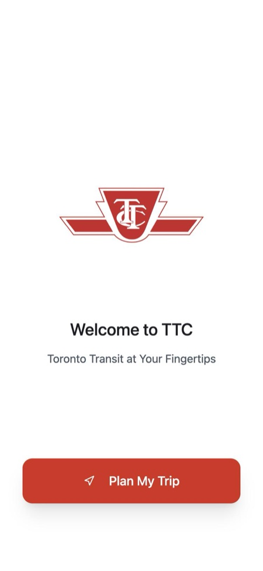
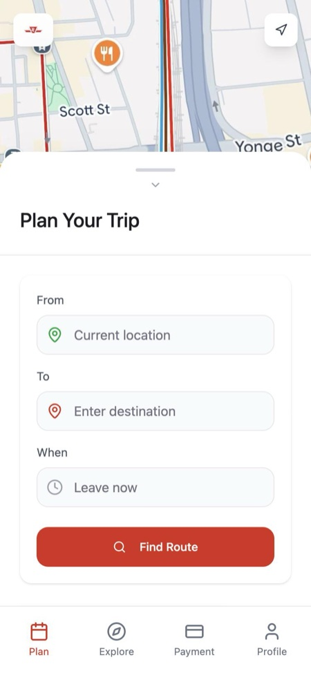
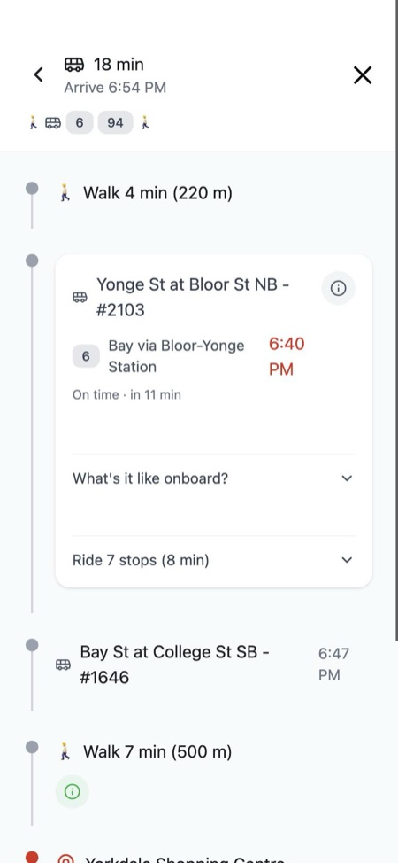
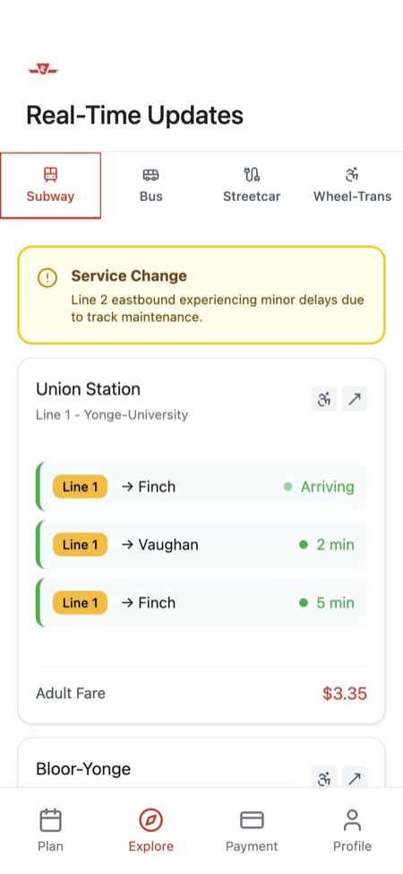

# TTC Transit App (MVP prototype)

**Toronto transit at your fingertips.** A clickable mobile app prototype for Toronto Transit Commission (TTC) riders: plan a trip, follow it step by step, track your vehicle live, check real-time arrivals across subway, bus, streetcar and Wheel-Trans, manage payment, and get help from a support chat.

> This is an MVP prototype made for the TTC. It is not an official TTC app, and nothing in it is live: arrival times, routes, fares, alerts and the "John Doe" profile are all sample data.

| Welcome | Plan a trip | Journey details | Real-time updates |
| --- | --- | --- | --- |
|  |  |  |  |

## What's in it

- **Welcome:** animated TTC logo and a "Plan My Trip" start button
- **Plan:** map with a trip planner (from, to, when) that opens a sample route
- **Journey details:** step-by-step trip with walking legs, stops, live departure times and "what's it like onboard?"
- **Live tracking:** a live map view of your vehicle once you start the journey
- **Explore (real-time updates):** arrivals by station for subway, bus, streetcar and Wheel-Trans, with service-change alerts and fares
- **Payment:** saved payment methods
- **Profile:** language selection, accessibility options and chat support with a virtual assistant

Navigation uses a bottom tab bar (Plan, Explore, Payment, Profile). The code also contains a few screens from earlier iterations (for example Home, Fare and Favorites) that aren't linked from the current flow.

## Run it locally

You need [Node.js](https://nodejs.org) 20 or newer.

```bash
npm install
npm run dev
```

Then open the address it prints (usually http://localhost:5173). The layout is designed for a phone-width screen, so it looks best with your browser's device toolbar set to a phone, or in a narrow window.

```bash
npm run build     # production build into dist/
npm run preview   # serve the production build
```

## How it was built

Designed and built in [Figma Make](https://www.figma.com/make/), then exported. Changes made after export so it runs outside Figma:

- `package.json`: added React and React DOM (Figma provides them itself) and removed duplicate entries Figma adds for its own package loader
- `vite.config.ts`: Figma's code imports packages with a pinned version (for example `sonner@2.0.3`); a small resolver maps those to the installed packages, so the code stays exactly as Figma wrote it
- `BottomNav.tsx`: the tab bar now stays above page content, so it can be tapped on the Explore screen

**Stack:** React 18, TypeScript, Vite, Tailwind CSS 4, shadcn/ui (Radix UI), lucide icons, Motion.

## Credits

- The TTC name and logo are trademarks of the Toronto Transit Commission.
- The map on the Plan screen is a static screenshot used for illustration; the map and its data belong to their respective owners.
- UI components from [shadcn/ui](https://ui.shadcn.com/), used under the [MIT license](https://github.com/shadcn-ui/ui/blob/main/LICENSE.md).
